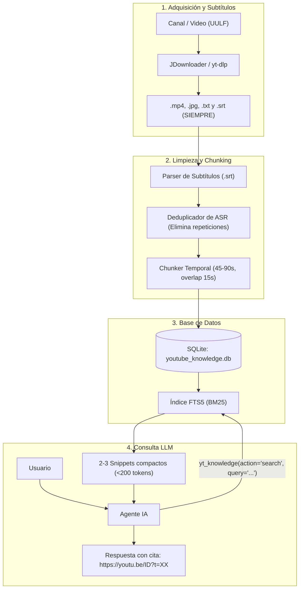

# Sistema de Memoria Audiovisual de YouTube con IA (Especificación Técnica y MVP)

## 1. Título de la propuesta
**Sistema de Memoria Audiovisual e Indexación Semántica de YouTube con IA (YouTube Audiovisual Knowledge Memory)**

---

## 2. Descripción general
Sistema local y ligero de base de conocimiento audiovisual que permite catalogar, transcribir, indexar y consultar videos de YouTube mediante lenguaje natural. 

El sistema se apoya en el servidor MCP existente (**`proyec_jdw2`**) y JDownloader para la adquisición de videos y sus subtítulos nativos sincronizados (`.srt`). Mediante una base de datos local SQLite con búsqueda de texto completo (**FTS5 / BM25**) y una herramienta MCP compacta de divulgación progresiva (inspirada en la arquitectura de `n8n-mcp`), el usuario puede formular preguntas a un LLM sobre su biblioteca y recibir respuestas fundamentadas con enlaces directos al segundo exacto (`https://youtu.be/<ID>?t=segundos`) y la ruta del archivo local.

---

## 3. Problemas resueltos y decisiones de arquitectura

A partir de la revisión técnica crítica, se han resuelto los 5 puntos de fricción del diseño inicial:

| Punto Crítico Anterior | Solución y Ajuste en esta Especificación |
| :--- | :--- |
| **1. Regla de idioma vs. Transcripción** | **Se conserva el `.srt` SIEMPRE**, independientemente del idioma. Un archivo `.srt` pesa entre 30 y 80 KB; descartarlo en español obligaba absurdamente a procesar Whisper por horas. En español y en cualquier idioma se conserva el `.srt`. |
| **2. Restricción de YouTube Captions API** | La YouTube Data API v3 (`captions.download`) exige OAuth del dueño del canal (con API Key da 403). **Vías reales de subtítulos:** 1) JDownloader descargando el `.srt` (vía principal), 2) `yt-dlp --write-auto-subs --skip-download` (extracción directa sin video), 3) `youtube-transcript-api` (fallback ligero). |
| **3. Subtítulos automáticos (ASR) sucios** | Los subtítulos ASR de YouTube vienen con líneas repetidas y solapadas (*rolling cues*). Se incorpora un **pipeline de deduplicación y normalización de texto** previo al chunking. |
| **4. Cómputo de Whisper** | Whisper queda confinado a una cola en segundo plano como contingencia excepcional para videos sin subtítulos. Nunca se ejecutará de forma síncrona dentro de una llamada MCP. |
| **5. Filtro de Shorts y UULF** | El uso de la playlist nativa `UULF...` ya excluye Shorts y transmisiones en vivo. Se elimina el filtro rígido $\le 180$s para evitar descartar erróneamente videos técnicos cortos legítimos. |

---

## 4. Alcance del Proyecto: Enfoque MVP por Fases

Para evitar la sobreingeniería y el sobredimensionamiento inicial, el proyecto se acota a un **MVP funcional inmediato** y fases evolutivas:

### Fase 1: MVP Inmediato (Núcleo Funcional)
1. **Regla de captura limpia:** JDownloader descarga Video (`.mp4`), Miniatura (`.jpg`), Descripción (`.txt`) y Subtítulos (`.srt`). El audio suelto (`.m4a`) se elimina en todos los casos.
2. **Parser y Limpiador de `.srt`:** Lee el archivo `.srt`, deduplica líneas repetidas de subtítulos automáticos (ASR) y limpia solapamientos.
3. **Chunking Temporal con Timestamps:** Agrupa el texto limpio en bloques de 45 a 90 segundos con 15 segundos de solapamiento, conservando `start_seconds`, `end_seconds` y la URL `?t=segundos`.
4. **Base de Datos SQLite + FTS5:** Almacenamiento local en archivo único (`youtube_knowledge.db`) con tabla virtual FTS5 para búsquedas ultrarrápidas con algoritmo BM25.
5. **Herramienta MCP Única (`yt_knowledge`):** Una sola herramienta polimórfica con dos acciones:
   - `action="search", query="..."`: Búsqueda compacta (devuelve los mejores 2-3 fragmentos con timestamps, consumo $< 250$ tokens).
   - `action="get_context", video_id="...", timestamp=...`: Ampliación de contexto a demanda si el usuario repregunta.
6. **Snapshots de seguridad y `READ_ONLY_MODE`:** Copias automáticas de la base de datos previa a modificaciones y control de modo lectura por variable de entorno.

### Fase 2: Automatización y Trazabilidad Local
1. **Vinculación de `local_path`:** Actualizar el registro del video en SQLite con la ruta absoluta donde JDownloader guardó el archivo en disco.
2. **Ingesta por lotes (CLI):** Comando `python cli_youtube.py index --channel <canal>` para escanear carpetas de descargas y procesar `.srt` pendientes.

### Fase 3: Evaluación y Embeddings (Opcional / A Demanda)
1. **Medición de precisión:** Evaluar si FTS5 (BM25) cubre la totalidad de consultas sobre videos técnicos.
2. **Embeddings semánticos:** Incorporar un modelo multilingüe local (`bge-m3` o `multilingual-e5`) solo si se detecta necesidad de búsqueda conceptual sin coincidencia léxica.

*(Nota: Almacenamiento en la nube y exportación a Anki quedan formalmente fuera del alcance de las Fases 1 y 2).*

---

## 5. Requisitos funcionales (MVP)

| ID | Requisito | Descripción | Criterio de Aceptación |
| :--- | :--- | :--- | :--- |
| **RF-01** | **Conservación Universal de Subtítulos** | JDownloader o yt-dlp conservan el archivo `.srt` en todos los idiomas (incluido español). | Todo video ingresado al LinkCollector cuenta con su archivo `.srt` asociado. |
| **RF-02** | **Filtro de Pestaña "Videos" (UULF)** | Extraer exclusivamente videos de la playlist nativa `UULF...`, excluyendo Shorts y Lives. | Se catalogan únicamente las subidas estándar del canal sin filtros rígidos de duración. |
| **RF-03** | **Deduplicador de Subtítulos ASR** | Filtrar solapamientos y frases repetidas de subtítulos automáticos de YouTube. | Texto limpio y continuo sin duplicidades de palabras causadas por el efecto karaoke. |
| **RF-04** | **Chunking con Marcas Temporales** | Segmentar el texto en ventanas de 45 a 90s con 15s de solapamiento. | Cada chunk almacena `start_seconds`, `end_seconds`, `video_id` y `url_timestamp`. |
| **RF-05** | **Almacenamiento SQLite + FTS5** | Indexar chunks en SQLite local mediante tabla virtual FTS5. | Búsquedas resueltas en $< 10$ ms en local con ranking BM25. |
| **RF-06** | **Herramienta MCP Única (`yt_knowledge`)** | Tool unificada para búsqueda compacta y ampliación de contexto. | La búsqueda devuelve máximo 2 o 3 fragmentos breves con enlace `?t=...`. |
| **RF-07** | **Snapshots de Base de Datos** | Copia de seguridad automática de `youtube_knowledge.db` antes de ingestas. | Restauración inmediata de la base en caso de fallo durante el procesamiento. |
| **RF-08** | **Modo Solo Lectura (Gobernanza)** | Variable de entorno `READ_ONLY_MODE=true` para bloquear escrituras o descargas. | El LLM solo puede consultar conocimiento, sin permisos de borrado. |

---

## 6. Arquitectura Técnica y Esquema de Datos

### 6.1. Esquema de Base de Datos SQLite (`youtube_knowledge.db`)

```sql
-- 1. Catálogo de videos gestionados
CREATE TABLE videos (
    video_id TEXT PRIMARY KEY,
    title TEXT NOT NULL,
    channel TEXT NOT NULL,
    url TEXT NOT NULL,
    duration_seconds INTEGER,
    published_at TEXT,
    local_path TEXT,          -- Ruta absoluta en disco (NULL si aún no se descarga)
    has_subtitles BOOLEAN DEFAULT 0,
    created_at TIMESTAMP DEFAULT CURRENT_TIMESTAMP
);

-- 2. Chunks de texto con marcas temporales
CREATE TABLE segments (
    id INTEGER PRIMARY KEY AUTOINCREMENT,
    video_id TEXT REFERENCES videos(video_id) ON DELETE CASCADE,
    start_seconds INTEGER NOT NULL,
    end_seconds INTEGER NOT NULL,
    timestamp_url TEXT NOT NULL,  -- https://youtu.be/<ID>?t=<start_seconds>
    text TEXT NOT NULL
);

-- 3. Índice de Búsqueda de Texto Completo (FTS5)
CREATE VIRTUAL TABLE segments_fts USING fts5(
    text,
    content='segments',
    content_rowid='id',
    tokenize='unicode61'
);

-- Triggers para sincronización automática entre segments y segments_fts
CREATE TRIGGER segments_ai AFTER INSERT ON segments BEGIN
  INSERT INTO segments_fts(rowid, text) VALUES (new.id, new.text);
END;

CREATE TRIGGER segments_ad AFTER DELETE ON segments BEGIN
  INSERT INTO segments_fts(segments_fts, rowid, text) VALUES('delete', old.id, old.text);
END;
```

---

## 7. Pipeline de Procesamiento de Subtítulos (Deduplicación)

Los subtítulos ASR de YouTube tienen un formato donde cada entrada repite el final de la anterior:
```
00:00:01,000 --> 00:00:03,000
hola amigos hoy vamos a ver

00:00:03,000 --> 00:00:05,500
hoy vamos a ver cómo funcionan los agentes
```

### Algoritmo de Normalización:
1. **Fusión de texto:** Se comparan las palabras del bloque entrante con las últimas palabras del bloque acumulado.
2. **Eliminación de prefijo común:** Si el inicio de la nueva línea coincide con el final de la anterior, se descartan los términos duplicados.
3. **Agrupación en ventana temporal:** Se acumulan líneas hasta alcanzar entre 45 y 90 segundos de duración acumulada.
4. **Cierre de bloque y overlap:** Se cierra el chunk, se asigna `start_seconds` (tiempo de la primera línea) y `end_seconds` (tiempo de la última), y se inicia el siguiente bloque 15 segundos antes del final.

---

## 8. Diseño de la Herramienta MCP Única (`yt_knowledge`)

Siguiendo el patrón de `n8n-mcp` para evitar saturación de tokens:

```python
@mcp.tool()
def yt_knowledge(
    action: str = "search",
    query: str = "",
    video_id: str = "",
    timestamp_seconds: int = 0,
    limit: int = 3,
) -> str:
    """Consulta la base de conocimiento audiovisual de videos de YouTube.
    
    Acciones disponibles:
    - 'search': Búsqueda rápida por palabras clave (devuelve 2-3 fragmentos compactos con timestamp).
    - 'get_context': Amplía el contexto alrededor de un timestamp específico (requiere video_id y timestamp_seconds).
    - 'stats': Muestra estadísticas de la biblioteca (total de videos y segmentos indexados).
    """
```

### Formato de respuesta para `action="search"` (Ultra-compacto, ~150-200 tokens):
```json
[
  {
    "video_title": "Trabajaba 14 horas por día y terminé en el hospital",
    "video_id": "O0ZVLrX6yto",
    "timestamp_str": "08:14",
    "timestamp_url": "https://youtu.be/O0ZVLrX6yto?t=494",
    "snippet": "...el problema del burnout no es trabajar mucho, es no tener pausas activas ni desconexión...",
    "local_file": "C:\\Descargas\\001.- Trabajaba 14 horas...mp4"
  }
]
```

---

## 9. Flujo Operativo del MVP



---

## 10. Consideraciones Finales y Siguientes Pasos
- **Inicio inmediato:** La implementación del parser `.srt` + deduplicador + tabla FTS5 en SQLite no requiere librerías pesadas (utiliza módulos nativos de Python: `sqlite3`, `re`, `pathlib`).
- **Validación previa:** JDownloader ya está configurado y probado para descargar el `.srt` junto con el video en tu carpeta local.
- **Sin bloqueos externos:** Al trabajar sobre los `.srt` descargados por JDownloader o extraídos con `yt-dlp`, no se depende de cuotas de APIs pagas ni de permisos OAuth.
